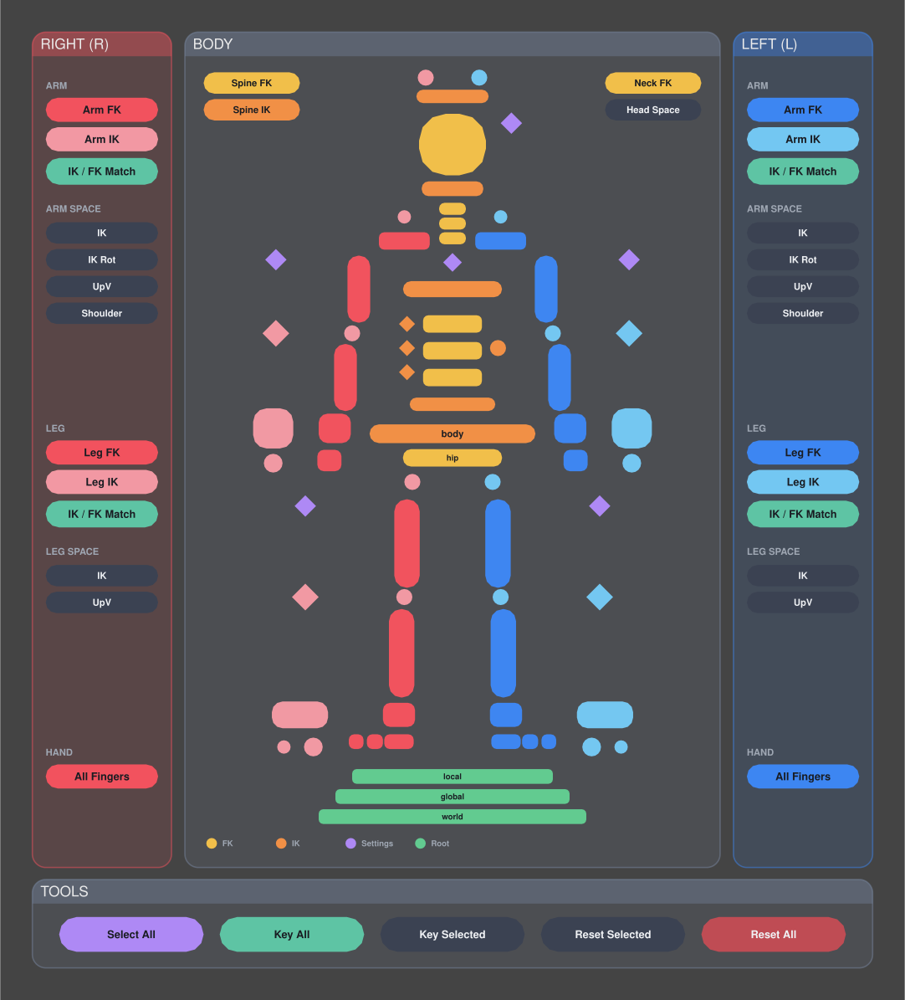
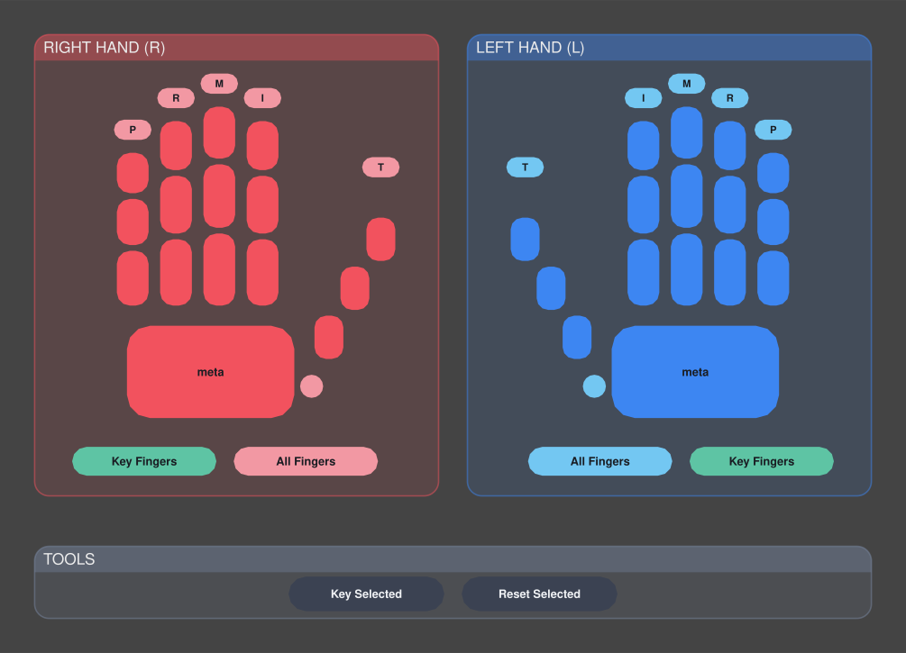

# 9ame mGear Templates

## Biped Anim Picker

mGear 기본 **Biped 가이드**(`biped template`)로 빌드한 리그에서 쓰는 Anim Picker 템플릿입니다.
mGear 공식 `biped.pkr`과 같은 컨트롤 104개를 다루고, 섹션별 패널로 레이아웃을 새로 짰습니다.

| Body | Hands |
| --- | --- |
|  |  |

> 미리보기 SVG는 생성기가 같은 데이터로 그린 이미지입니다. 실제 Anim Picker 화면과 폰트·외곽선이 조금 다를 수 있습니다.

### 사용법

1. Maya에서 `mGear > Anim Picker > Anim Picker` 실행
2. 피커 창 상단의 `Load` 버튼 → `templates/biped_anim_picker.pkr` 선택
3. 씬에 저장해 두려면 `New`로 피커 노드를 만든 뒤 불러오고 `Save` 합니다.
4. 리그가 레퍼런스(네임스페이스 사용)라면 피커 상단에서 네임스페이스를 선택합니다.
   선택하지 않아도 버튼이 선택한 컨트롤의 네임스페이스를 쓰고, 선택이 없으면 씬에 리그가 하나뿐일 때 그 리그를 자동으로 찾습니다.

> `.pkr`을 `File > Open`/`Import`나 드래그&드롭으로 열면 `performFileAction.mel ... No translator found.` 에러가 납니다
> (`.pkr`은 Maya 씬이 아닙니다. 드래그&드롭은 최신 mGear에서만 지원). 이때는 스크립트 에디터(Python)에서 바로 불러오세요:
>
> ```python
> PKR_PATH = r"D:/9ame_mgearTemplates/templates/biped_anim_picker.pkr"
> exec(open(r"D:/9ame_mgearTemplates/tools/load_picker.py", encoding="utf-8").read())
> ```

### 구성

**Body 탭**
- 가운데 **BODY**: 몸 전체 컨트롤 (FK = 진한 색, IK = 밝은 색, 보라 마름모 = 세팅/UI 컨트롤, 초록 = 루트)
  - 좌상단 `Spine FK` / `Spine IK`, 우상단 `Neck FK`: 여러 컨트롤을 한 번에 선택
  - `Head Space`: 목/머리 IK 스페이스 전환 메뉴
- 좌우 **RIGHT (R) / LEFT (L)** 패널
  - `Arm FK` / `Arm IK` / `Leg FK` / `Leg IK`: 체인 전체 선택
  - `IK / FK Match`: 현재 상태의 반대로 전환하면서 포즈를 맞춤 (`mgear.core.anim_utils.ikFkMatch_with_namespace`)
  - `ARM SPACE` / `LEG SPACE`: 클릭하면 스페이스 목록 팝업 (IK, IK Rot, UpV, Shoulder)
  - `All Fingers`: 그 손의 손가락 전체 선택
- 하단 **TOOLS**: `Select All`, `Key All`, `Key Selected`, `Reset Selected`, `Reset All`
  - All 계열 버튼은 리그의 `rig_controllers_grp` 셋 기준이고, Reset은 키 가능한 속성을 기본값으로 되돌립니다(Undo 한 번으로 취소 가능).
- 하단 **TOOLS 둘째 줄 (미러)**
  - `Copy L → R` / `Copy R → L`: 한쪽 팔·어깨·손가락·다리·발 포즈를 반대쪽에 복사 (IK/FK 상태 포함, 몸통·눈은 그대로)
  - `Mirror Selected`: 선택한 컨트롤을 반대쪽에 복사 (가운데 컨트롤은 반전)
  - `Flip Selected`: 선택한 컨트롤의 좌우 포즈를 맞바꿈
  - **키가 있는 상태에서도 동작합니다.** mGear 기본 미러는 키가 있는 속성을 건너뛰어서 애니메이션 중에는 안 먹습니다. 이 버튼들은 키가 있는 속성은 현재 프레임에 키로, 키가 없는 속성은 값으로 넣습니다. 반전 방향은 mGear와 같이 컨트롤의 `inv*` 속성을 따르고, 리그에서 잠긴 채널(예: 스케일)은 조용히 건너뛰고, constraint 등으로 연결된 속성만 건너뛰면서 경고합니다. Undo 한 번으로 키까지 취소됩니다.

**Hands 탭**
- 손가락 마디별 컨트롤 (`finger_X0~3` = 검지~새끼, `thumb`, `thumbRoll`, `meta`)
- 손가락 위의 `I M R P T` 칩: 해당 손가락 체인 전체 선택
- `All Fingers`, `Key Fingers`: 손가락 전체 선택/키
- `Hand L → R` / `Hand R → L`: 한쪽 손가락 포즈를 반대쪽 손에 복사

화면 기준으로 캐릭터의 **L(왼쪽)은 오른쪽**, **R(오른쪽)은 왼쪽**에 있습니다(캐릭터를 뒤에서 보는 방향, mGear 기본 템플릿과 동일).

### 호환성

- 섹션 패널은 **Anim Picker 2.0**(mGear 최신 버전)의 backdrop 기능(둥근 패널 + 타이틀 바)을 사용합니다.
  이전 버전에서는 패널이 반투명 사각형으로 보이고, 선택/버튼 기능은 그대로 동작합니다.
- 실제 Maya 안에서는 아직 테스트하지 않았습니다. 파일은 mGear 소스의 `PickerItemData`로 읽고 쓰는 검사만 통과했습니다.

### 내 리그에 맞추기

컨트롤 이름이 다르거나(예: 다리 컴포넌트 이름 변경, 손가락 개수 차이) 레이아웃을 고치고 싶으면
생성기를 수정한 뒤 다시 만듭니다. Maya 없이 Python 3만 있으면 됩니다.

```bash
python tools/build_biped_picker.py
```

- 색상: 파일 상단 `COLOR` 딕셔너리
- 몸/팔/다리 위치·크기: `build_body_tab`, `build_arm`, `build_leg`
- 좌우 패널 버튼: `build_side_panel`
- 손: `build_hand`

리그에 없는 컨트롤을 확인하려면 Maya 스크립트 에디터(Python)에서:

```python
PKR_PATH = r"D:/9ame_mgearTemplates/templates/biped_anim_picker.pkr"
NAMESPACE = ""  # 레퍼런스 리그면 네임스페이스 입력
exec(open(r"D:/9ame_mgearTemplates/tools/check_picker_controls.py", encoding="utf-8").read())
```
